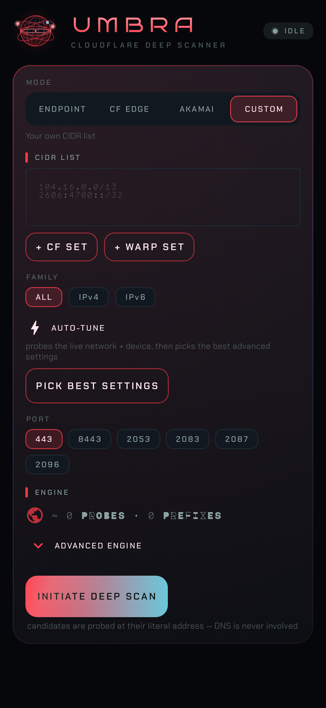
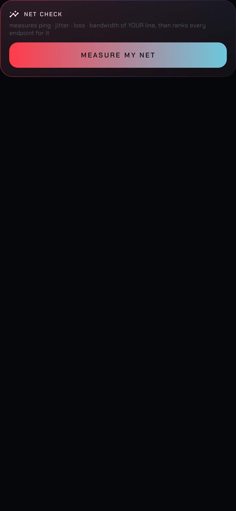
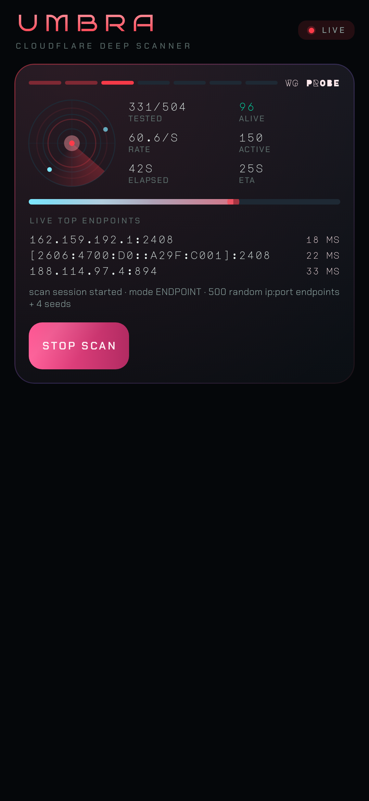
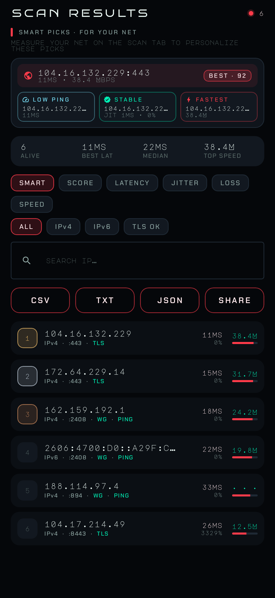
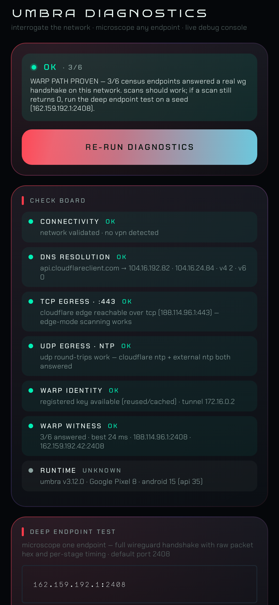
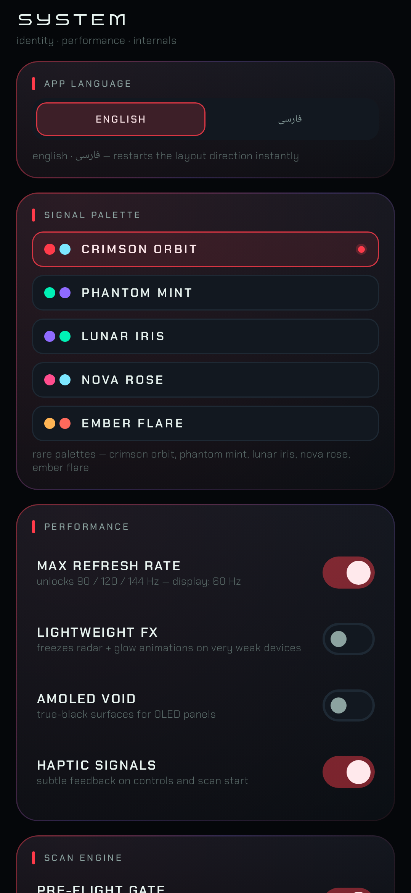
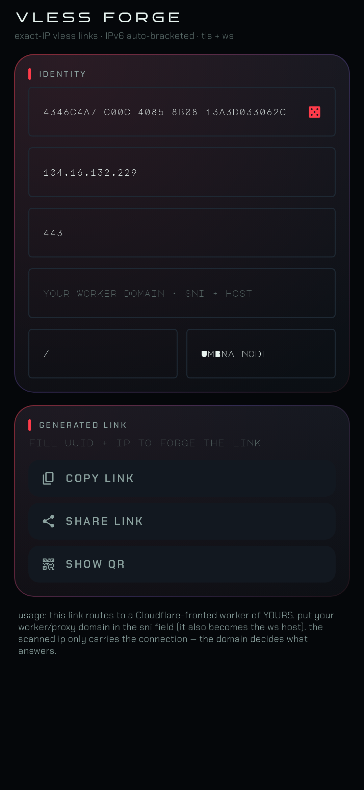
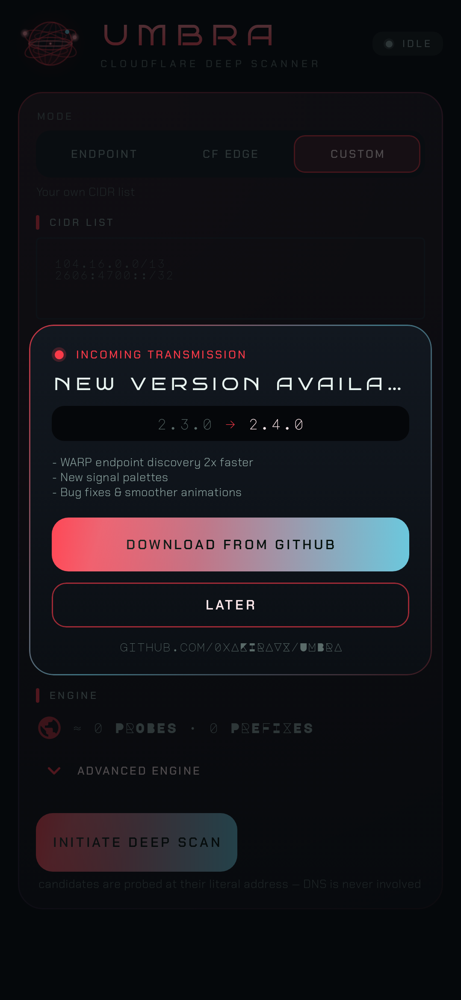

<p align="center">
  
</p>

<h1 align="center">U M B R A</h1>

<p align="center">
  <strong>A native Android scanner that hunts for the fastest Cloudflare &amp; WARP endpoints on your network — and turns the winner into a ready-to-use VLESS config.</strong>
</p>

<p align="center">
  <a href="https://github.com/0xAKIRAVX/UMBRA/releases"></a>
  
  
  
  
  
  
</p>

---


## Why UMBRA

Your connection to Cloudflare's edge is only as good as the *specific IP* your network happens to reach. Some Cloudflare IPs answer in 15 ms with zero loss; others sit behind congested routes and quietly throttle your throughput. Cloudflare's own client never tells you which IP you got — and never lets you choose.

**UMBRA flips the table.** It samples the live Cloudflare and WARP address space directly from *your* device, measures what your network *actually* delivers to each candidate — latency, packet loss, a real WireGuard handshake, an in-tunnel ping, real download speed — ranks everything for you, and generates a VLESS config bound to the winner.

No root. No Termux. No server.


## iOS sibling (new)

The **Swift / SwiftUI port** now lives in [`ios/`](ios/) — same engine
architecture (real WireGuard handshake validation, pre-flight witness gate,
recovery ladder, smart ranking, VLESS builder), EN + FA with full RTL, and
byte-identical crypto: the shared `warp_vectors.json` reference vectors (the
ones live-verified against production WARP endpoints) pass on BOTH
platforms, so the iOS app speaks exactly the same wire protocol.

**Installing on an iPhone with NO computer:** the repo's CI
(`.github/workflows/ios-build.yml`) builds an unsigned IPA on a
GitHub-hosted Mac and publishes it to the rolling
[`ios-latest` release](https://github.com/0xAKIRAVX/UMBRA/releases) —
download `UMBRA-unsigned.ipa` in Safari, then sign & install **on the
iPhone itself** with **Esign / Scarlet** (on-device signing, free
certificates; 7-day validity for a personal Apple ID — re-sign the same
IPA after that). The step-by-step guide (in Persian) is
[`ios/INSTALL-FA.md`](ios/INSTALL-FA.md). With a computer:
*Actions → Artifacts* + Sideloadly/AltStore works too. With a Mac: open
`ios/UMBRA.xcodeproj` in Xcode 15+, pick your team, Cmd+R — no
dependencies, no entitlements. See [`ios/README.md`](ios/README.md).

---

## Three cores, one app

The scanning core lives in **three languages**, each doing what it is best at:

| Core | Language | Job |
| --- | --- | --- |
| **umbra-core** | **Rust** — ~2k lines, std only, zero dependencies | The WireGuard engine: X25519, BLAKE2s, ChaCha20-Poly1305, the Noise_IKpsk2 handshake, TAI64N anti-replay, the UDP probe storm with its budget ladder and in-tunnel ICMP ping. Real OS threads, keys from `/dev/urandom`, the replay high-water mark persisted across restarts. Loaded through JNI (`libumbra_core.so`, 3 ABIs). |
| **goclean** | **Go** — gomobile AAR | The clean-IP engine: TCP latency, real TLS certificate validation against the platform trust store, `/cdn-cgi/trace` colo checks with the zone-routing filter, and `/__down` speed tests — all on goroutines. A desktop CLI runs the identical engine off-device for cross-verification. |
| **orchestrator + UI** | **Kotlin 2.0** + Jetpack Compose M3 | The brain and the face: recovery ladder, witness gate, re-aim, identity registration, ranking, VLESS generation, i18n, export. If a native core is ever missing, an honest pure-Kotlin fallback takes over — and says so in the log. |

The Rust core's bytes are pinned by a differential vector suite (`tests/vectors.rs` reuses the same `warp_vectors.json` the Kotlin suite has verified against production since v3.5, including a closed-loop handshake against a test responder) — the Rust and Kotlin implementations are proven to speak identical bytes.

---

## How a scan works

```
identity ─▶ witness gate ─▶ recovery ladder ─▶ probe storm ─▶ validation ─▶ ranking ─▶ VLESS
```

| Stage | What happens |
| --- | --- |
| **Identity** | A free WARP account is registered silently (15-min in-process TTL, disk fallback, and pinned-IP SNI-routed registration that survives DNS poisoning). The key is only a probe key — you never see or manage it. |
| **Witness gate** | 4 census seeds + 12 random pool pairs, balanced IPv4/IPv6, prove the network path in one ~2 s round before the storm. Any answer → the storm rolls. |
| **Recovery ladder** | If the witness round is silent, a full-port sweep — all 56 canonical WARP ports × census + pool IPs, v4 grid first then IPv6 twins — hunts for *any* answering path and re-aims the whole scan onto the proven ports and family automatically. |
| **Probe storm** | Up to 320 elastic concurrent UDP lanes with a budget ladder: full timeout on the first attempt, halved retries, and an early stop the moment an endpoint is proven. |
| **Validation** | Every endpoint that answers gets a **full Noise_IKpsk2 WireGuard handshake** (native Rust core) and an **ICMP echo ping inside the encrypted tunnel** — the same guarantee a server-side scan gives, on your phone. |
| **Ranking** | Results are scored *relative to your own measured line* (NET CHECK): excellent lines weigh throughput, rough lossy lines weigh stability and ping. |
| **VLESS** | One tap turns the winner into a `vless://` URL + QR code, with IPv6 correctly bracketed. |

---

## Scan modes

| Mode | Probes | Proven by |
| --- | --- | --- |
| **ENDPOINT** *(default)* | Random `ip:port` pairs from the Cloudflare WARP pools — `162.159.19x` / `188.114.9x` / `8.x` /24s plus their `2606:4700:d0::/d1::` IPv6 twins — each endpoint with its own random port from the 55-port canonical list (or one pinned port) | Real WireGuard handshake + in-tunnel ping (Rust core) |
| **EDGE** | Random samples of 14 IPv4 + 7 IPv6 Cloudflare edge CIDRs | Go clean-IP engine: TCP + TLS + colo trace (zone-routing filter) + exact-IP speed test |
| **CUSTOM** | Your own pasted CIDR list, any family | Same as EDGE |

---

## Real validation — not "TCP-alive"

Plenty of scanners call an endpoint alive when a TCP connect completes. On Cloudflare's anycast edge, *every* edge IP accepts TCP on :443 — whether or not that address serves WARP on that port. A TCP-alive list pasted into WireGuard / v2rayNG / Hiddify connects to nothing.

UMBRA only reports endpoints it has **cryptographically proven**: a real Noise_IKpsk2 handshake from a silently-registered identity to that exact `ip:port`, followed by an ICMP echo inside the encrypted tunnel. If the handshake is not answered, the endpoint never reaches the board. On the clean-IP side, the zone-routing filter discards anycast IPs that answer error 1034 — real Cloudflare, but not *your* zone, and never working in an IP-pinned config.

The WireGuard protocol stack lives in the native Rust core, byte-for-byte pinned against the same production-verified test vectors the pure-Kotlin implementation grew up on (which remains as the honest fallback). No xray core, no generic VPN binary — two purpose-built cores you can read end-to-end.

---

## An honest scanner

A scanner built for filtered networks has to tell the truth about *failure* — otherwise it's useless. UMBRA diagnoses its own environment instead of shrugging:

- **Active-VPN detection** — a system VPN (v2rayNG, Hiddify, …) silently swallows UDP inside TCP-only tunnels. UMBRA detects it *before* probing and pins the explanation to any negative verdict.
- **NTP witness triage** — "UDP is blocked" is three different problems: no UDP at all, Cloudflare filtered, or WARP ranges selectively dropped. Two NTP witnesses (in-network and out-of-network) tell them apart, and each verdict ends with its matching remedy.
- **Zero-result scans diagnose themselves** — the Done panel names the world you're in: probe-failure tallies (`handshake timeout ×N`), the witness verdict, the VPN state. No silent empty boards, ever.
- **Ghost-key self-heal** — WARP responders drop unknown keys with zero replies (anti-enumeration), so a dead stored identity looks exactly like a dead network. The fresh-identity round tells them apart and swaps the key in.
- **Crash journal** — every crash (version, device, full stack trace) lands in an on-disk journal readable in-app, with a one-tap copy report.

---

## Diagnostics &amp; debug

The **DIAG** and **DEBUG** tabs turn the app into its own microscope:

- **FULL DIAGNOSTICS** — one button runs the whole interrogation: connectivity, system-VPN detection, DNS resolution of the registration API, TCP egress, UDP egress (NTP witnesses), WARP identity state, and live WireGuard handshakes against the census seeds (v4 + v6). The result is a plain-words **verdict** naming the exact failure class — from `NO USABLE NETWORK` through `SYSTEM VPN IS ACTIVE AND UDP IS DEAD INSIDE ITS TUNNEL` to `WARP PATH PROVEN — SCANS WILL WORK` — with an evidence check board underneath.
- **DEEP ENDPOINT TEST** — the single-endpoint microscope. Paste any `ip`, `ip:port`, `[v6]:port` or `host:port` and watch the exact handshake attempt: per-stage timings (parse → resolve → identity → packet build → send → wait), the **raw hex of the 148-byte initiation packet annotated field-by-field** (type · sender index · ephemeral · encrypted static/timestamp · MAC1/MAC2), the reply's hex, and a byte-level classification: `HANDSHAKE_OK`, `COOKIE_REPLY` (alive under load), `SILENT`, `SOCKET_ERROR` (the path actively rejected you), `REPLY_UNPARSEABLE` (a QUIC co-host answered). Shareable as a plain-text report.
- **DEBUG CONSOLE** — the app-wide journal. Every layer mirrors into one ordered stream: scan log lines, crash-journal events, NETSENSE steps, update checks, diagnostics progress. Filterable by tag, color-coded by severity, ring-capped at 800 entries, thread-safe across the engine's probe lanes — and with the optional per-probe stream on, every WG packet (sizes, hex previews, round-trip timings) and every clean-IP verdict appears live.

---

## Feature matrix

| Capability | Detail |
| --- | --- |
| **Native tri-lingual cores** | Rust WireGuard engine + Go clean-IP engine + Kotlin orchestration, with an honest pure-Kotlin fallback when a core is missing |
| **WARP endpoint scan** | Random `ip:port` endpoints from 14 BPB-verified ranges — the classic `162.159.192.0/24` family **plus the newer `8.x` WARP space** many ISPs haven't throttled yet |
| **Real WireGuard validation** | Full **Noise_IKpsk2 handshake over UDP** + **ICMP echo inside the encrypted tunnel** for every reported endpoint (native Rust core) |
| **Clean-IP engine (Go)** | TCP latency, real TLS validation against the platform trust store, colo tracing with the **zone-routing filter** (error-1034 anycast IPs discarded), `/__down` speed tests |
| **Fresh WARP identity per scan** | Silent registration on `api.cloudflareclient.com` (the wgcf flow), pinned-IP SNI-routed fallback, disk persistence, ghost-key self-heal |
| **IPv4 + IPv6 first-class** | Half/half family split, v6-embedded twins of every v4 pool address, proper `[2606:4700:d0::…]:2408` bracketed output |
| **Port strategy** | Random port per endpoint from the 55-port canonical list, or a pinned port — plus the automatic 56-port recovery sweep |
| **Recovery ladder** | Full-port sweep + re-aim onto proven paths: a port-filtered network becomes a working scan instead of a 0-alive abort |
| **Full diagnostics** | One-button network interrogation with a plain-words verdict for every failure class, evidence check board, live WG witnesses |
| **Deep endpoint test** | Single-endpoint microscope: per-stage timings, annotated hex of the 148-byte initiation, byte-level reply classification, shareable report |
| **Debug console** | App-wide journal + optional live per-probe stream (WG packets with hex previews and RTTs, clean-IP verdicts) |
| **NET CHECK / نت‌سنج** | Measures your own line — ping, jitter, loss, DPI-proof TLS RTT, exact-IP download **and upload**, IPv6 — and grades it عالی / خوب / متوسط / ضعیف |
| **SMART PICKS / انتخاب‌های هوشمند** | Adaptive BEST · LOW PING · MOST STABLE · FASTEST, baseline-relative scoring that shifts with your measured line |
| **AUTO-TUNE** | One-tap calibration — the port sweep validates each port with a live WireGuard handshake, so the tuned list is guaranteed to carry traffic |
| **VLESS generator** | One-tap `vless://` URLs + QR codes, IPv6 correctly bracketed (`vless://uuid@[2606:4700:…]:443`) |
| **Export** | Results as CSV, JSON, or TXT |
| **Self-update** | Silent GitHub release check on launch (24 h throttle) + animated in-app announcement with one-tap download |
| **English + فارسی** | Full bilingual interface with RTL mirroring, Vazirmatn typography, and a system-integrated per-app language config |
| **Background scans** | Foreground service with live notification + STOP action |
| **Privacy** | Zero analytics, zero trackers, zero data collection — everything stays on device |

---

## Screenshots

Real renders of the app's actual Compose UI — dark substrate, rare typefaces (Bruno Ace SC · Chakra Petch · Major Mono Display · Vazirmatn), spring physics and neon glow:

| Scan configuration | NET CHECK · نت‌سنج card |
| :---: | :---: |
|  |  |

| Live scan · radar console | Results · smart picks + board |
| :---: | :---: |
|  |  |

| Diagnostics · verdict + evidence board | System settings |
| :---: | :---: |
|  |  |

| VLESS generator · QR | Update announcement |
| :---: | :---: |
|  |  |

---

## Download

Grab the latest signed APK from the **[Releases](https://github.com/0xAKIRAVX/UMBRA/releases)** page.

| | |
| --- | --- |
| Latest version | **v4.0.2** (build 29) |
| Requirement | Android 8.0+ (API 26) |
| Architecture | Universal (arm64 / armv7 / x86_64) |
| Size | ~45 MB (three toolchains: Go runtime + Rust core, ×3 ABIs) |
| Permissions | `INTERNET` · `FOREGROUND_SERVICE` · `POST_NOTIFICATIONS` — nothing else |

> Install like any sideloaded app: download, open, allow "unknown sources" if asked, done.
>
> ⚠ **Upgrading from v3.1.1 or older?** The v3.2.0 APK is signed with a new release key that now lives **inside the repo** (`keystore/umbra-release.jks`) so every future build keeps the same signature — Android refuses an in-place update across different keys, so **uninstall the old UMBRA once, then install v3.2.0 or newer**. From v3.2.0 on, updates install over each other seamlessly. Nothing of value is lost (scans are per-session, settings take seconds to re-pick).

---

## Build from source

```bash
git clone https://github.com/0xAKIRAVX/UMBRA.git
cd UMBRA
./gradlew assembleRelease        # APK → app/build/outputs/apk/release/
./gradlew test                   # 284 unit tests
UMBRA_LIVE_TEST=1 ./gradlew test # + live-gated suites against production Cloudflare
```

The release APK ships **prebuilt native cores** (`app/src/main/jniLibs/<abi>/libumbra_core.so` and `native/goclean.aar`) — a plain checkout builds without any native toolchain. To rebuild the cores from source:

```bash
# Rust WG core → app/src/main/jniLibs/<abi>/libumbra_core.so
# (+ the host build for in-JVM tests → app/src/test/resources/native/)
scripts/build-native.sh release        # needs: rustup, NDK r27, JDK 17+

# Go clean-IP core → native/goclean.aar (gomobile)
cd native/goclean && gomobile bind -target=android/arm64,android/arm,android/amd64 \
    -androidapi 26 -javapkg com.umbra.scanner.goclean -o ../goclean.aar .

# Rust differential vectors (byte-for-byte WG protocol parity)
cd native/umbra-core && cargo test

# The Go engine as a desktop CLI (cross-verification from any network)
cd native/goclean && go run ./cmd/umbra-clean -samples 240 -speed 10
```

The release keystore ships in the repo (see [Signing](#signing)), so a checkout builds a release APK with the same signature as the official Releases — in-place updates over the installed app just work.

Live-gated suites (real WireGuard handshakes, endpoint scans, port sweeps, registration flows — including one that loads the host build of the exact same `.so` the phone uses) skip themselves unless `UMBRA_LIVE_TEST=1` is set, so CI machines and offline builds stay green.

---

## Tech stack

| Layer | Choice |
| --- | --- |
| WG core | **Rust** — ~2k lines, std only, zero dependencies; x25519 (51-bit limbs), ChaCha20-Poly1305, BLAKE2s, TAI64N, Noise_IKpsk2; real threads, JNI bridge, differential vectors shared with the Kotlin suite |
| Clean-IP core | **Go** — gomobile AAR; goroutine fan-out, TLS against the platform trust store, colo tracing, `/__down` speed tests; a desktop CLI runs the identical engine off-device |
| Orchestrator + UI | **Kotlin 2.0** + Jetpack Compose + Material 3, coroutines, spring physics, canvas visuals (OrbitGlobe), full RTL mirroring |
| Network | Raw UDP/TCP sockets from both cores, HTTPS-over-pinned-IP with SNI routing, NTP witness probes — no OkHttp, no Volley |
| Runtime dependencies | AndroidX/Compose, kotlinx-coroutines, zxing (QR), gomobile AAR, native `.so` — no xray core, no generic VPN binaries |
| Tests | 257 unit + regression tests, live-gated production suites, JDK-portability denylist (guards against desktop-only APIs that pass JVM tests and crash on devices) |

---

## Privacy

Zero analytics. Zero trackers. Zero data collection. Scans, measurements and the crash journal stay on your device; the only network traffic is the probing itself and the release check against GitHub. The one account UMBRA ever creates is an anonymous free WARP key it registers, uses, and keeps to itself.

---

## Troubleshooting

| Symptom | What it means | What to do |
| --- | --- | --- |
| Scan aborts fast with a verdict line | The scanner *proved* the path is filtered — the verdict names the world | Read it: VPN interference → disconnect the VPN and rescan; ISP filtering → the verdict suggests ports / IPv6 / another network |
| Verdict says "disconnect any active VPN" | A system VPN is swallowing the UDP probes inside its tunnel | Disconnect it, rescan — the verdict then describes your real network |
| Want proof of what's wrong with your network | The DIAG tab interrogates everything | Run **DIAG → FULL DIAGNOSTICS** and read the plain-words verdict + evidence board |
| A specific endpoint doesn't work | Find out exactly why, packet by packet | Run **DIAG → DEEP ENDPOINT TEST** on that `ip:port` — annotated hex, per-stage timings, byte-level classification — and share the report |
| `v6 0` in the completion split | Your route has no working IPv6 | Scan IPv4, or switch networks |
| Endpoints worked by UMBRA fail in another app | You're describing a build ≤ v3.7 (TCP-alive lists, no handshake proof) | Update to v3.8+ — endpoints are only reported after a real WireGuard handshake |
| Registration failures | DNS poisoning or a filtered registration API | Already handled in-app (pinned-IP SNI routing + disk identity); a stale identity self-heals on a reachable network |
| A scan that hangs forever | Not possible anymore — engine errors fail into the Done panel with the reason | Check **SETTINGS → CRASH LOG** and copy the report |

---

## Release history

| Version | Theme | Highlights |
| --- | --- | --- |
| **v4.0.2** | Go-path integrity pass | ACTIVE-lane counter poisoning fixed (Go's absolute busy counts were passed into a delta accumulator), duplicate-draw progress reconciliation on small CIDRs, Persian digits out of the colo log line, Turkish dotless-ı out of the notification, single hex-dump truncation marker, deep-test crash feedback |
| **v4.0.1** | Locale hardening + gate fixes | Persian/Arabic digits out of the ASCII engine logs, Turkish lowercase traps closed, debug toggle now actually gates the per-probe stream, diagnostics ↔ scan both-direction guard, WG deep-probe default port |
| **v4.0.0** | Tri-lingual rebuild | Rust WG core + Go clean-IP engine + Kotlin orchestration; DEBUG console with the live per-probe stream; ~45 MB |
| **v3.12.0** | Diagnostics | DIAG tab — full network interrogation verdicts, single-endpoint deep test with annotated hex, app-wide debug journal |
| **v3.11.0** | Bug-hunt polish | 6 defects fixed across engine, UI and i18n |
| **v3.10.0** | Recovery ladder | Automatic 56-port sweep, family-balanced witness, re-aim onto proven paths — the 0-alive fix |
| **v3.9.0** | Frozen-scan fix | Elastic probe lanes, budget ladder + proven-early-exit, pre-flight witness gate, storm heartbeat |
| **v3.8.1** | Full-codebase audit | 7 fixes: mode-switch toggle poisoning, pool dedup, `[ip]:port` display, RTL stat cells, splash tap-through |
| **v3.8.0** | Real validation | Full Noise_IKpsk2 handshake validation replaces the fakeable TCP probe; standalone WARP section removed |
| **v3.7.0** | ENDPOINT scanner | BPB-Warp-Scanner workflow on-device — random `ip:port`, IPv4 + IPv6, per-endpoint random ports |
| **v3.6.2** | Network diagnosis | Active-VPN detection, IPv6 rescue rounds, NTP witness evidence, untruncated verdicts |
| **v3.6.1** | Silent-failure classes | Live-census seed refresh, ghost-key self-heal, DNS-poison-proof pinned-IP registration |
| **v3.6.0** | Self-diagnosing engine | TAI64N replay-window fix, pre-flight gate, zero-result failure tallies |
| **v3.5.x** | The real WARP engine | Reserved-bytes fix, BigInteger portability, differential test vectors, zombie-scan fix |
| **v3.4.0** | Honest features | Real WARP+ license application, OOM-proof mega-sweeps, unbiased candidate capping |
| **v3.3.x** | Can't-crash-anymore | Crash journal, coroutine exception nets on every engine scope |
| **v3.2.0** | Second bug hunt | 11 fixes; one-time signature change (in-repo key since) |
| **v3.1.x** | NETSENSE | Net measurement card + SMART PICKS adaptive ranking, 9-fix patch |
| **v3.0.0** | Crimson Orbit | New icon, full فارسی UI + RTL, palettes, boot splash, OrbitGlobe |

<details>
<summary><strong>Full release notes</strong></summary>

### v4.0.2 — the Go-path integrity pass

A second fresh-eyes audit over the whole tri-lingual codebase, aimed at the paths the v4 rebuild grew around the Go clean-IP engine:

1. **The ACTIVE stat was poisoned on every CLEAN-IP scan.** The Go engine's `prg` events report the **absolute** number of busy goroutine lanes; the sink's `onActive` contract is a **delta** (the Kotlin storm sends +1/−1 around each probe). The pass-through added the whole busy count on every progress event — the ACTIVE figure on the stats card climbed monotonically to nonsense for the entire scan, on the app's primary mode. An absolute→delta converter now tracks the true lane count and flushes its residual to zero at scan end (cancellations included).
2. **Duplicate draws stranded the progress bar below 100%.** The Go sampler draws candidates **with replacement** (unlike the Kotlin generator, which deduplicates): on small CIDRs — a pasted /24 in CUSTOM mode — duplicate `ip:port` targets were probed twice while the result store merged them, so `tested` could never reach the announced `candidates` and the completion line overcounted. The engine now keeps a unique-id ledger and reconciles the announcement at scan end with an honest "duplicate ip draws merged" line.
3. **Two more locale traps closed.** The Go engine's colo narration line formatted its TLS time with the default locale (Persian digits inside the ASCII scan log on fa devices — the v4.0.1 sweep fixed the same class on the recovery sweep and missed this one), and the foreground notification lowercased the phase label with the default locale ("IDENTITY" → "ıdentıty" on Turkish devices, in the status bar of all places). Both pinned to `Locale.US`/`Locale.ROOT`.
4. **Deep-test crash feedback.** A crash inside the Diagnostics deep endpoint test used to return `null` and the button silently un-busied. The console now carries an honest "deep test crashed" line (the same crash-net contract the Debug tab's deep probe already had).
5. **Hex-dump truncation marker.** A truncated hex dump printed its "+N bytes" marker after **every** row; it now appears once, at the end.
6. 14 new regression tests (284/284 green), all live suites re-verified against production Cloudflare through both native cores (real WG handshakes + in-tunnel pings through the Rust core, ghost-key control, census, endpoint scan).

### v4.0.1 — locale hardening + gate fixes

1. **Locale hardening (8 code paths).** The app's engine diagnostics are ASCII by design, but the default FORMAT locale had other plans: on فارسی devices (this app's primary audience) the recovery-sweep log line and the diagnostics verdict rendered **extended Arabic-Indic digits** ("۵ ms"); on Turkish devices the default `lowercase()` turned "IPv4" into "ıpv4" (dotless ı) in the scan session line, made an all-caps `SPEED.CLOUDFLARE.COM` slip past the VLESS test-only guard (forging a link that never proxies), and broke the debug journal's level-inference keywords ("IDENTITY FAILED" painted INFO instead of WARN). Every spot is now pinned to `Locale.US`/`Locale.ROOT` and locked with regression tests that force hostile default locales first.
2. **The DEBUG toggle now actually gates the per-probe stream.** The Rust core's `probeOnce` always emits debug lines (it force-enables them for the deep probe), and the scan storm forwarded them unconditionally — every scan flooded the console with per-probe hex even with the toggle OFF, contradicting the persisted setting. The forwarding is now gated on the toggle; the deep probe keeps its full narration.
3. **Diagnostics ↔ scan is now a both-direction gate.** A scan starting mid-diagnostics raced the witness probes and registration exactly the way a scan starting mid-NETSENSE did before v3.2 fixed that direction — `startGate` now refuses while the interrogation is running, with the same honest "deferred" notice.
4. **WG deep-probe default port.** A bare IP typed into the WG deep probe defaulted to :443 (the clean-ip default) — WARP speaks 2408/894/928, so the probe honestly reported a dead endpoint for a live one. The default is now probe-specific (WG → 2408, CLEAN → 443).
5. **Crash-hardening for the deep probe.** The Compose scope has no crash net; an `Error` (OOM etc.) escaping the probe would kill the process — the exact class of failure CrashGuard exists to make survivable. The probe is now wrapped, and a failure prints as a line in the result panel.
6. 11 new regression tests (268/268 green), all live suites re-verified against production Cloudflare through both native cores.

### v4.0.0 — the tri-lingual rebuild (Rust + Go + Kotlin)

The scanning core now lives in three languages, each doing what it is best at:

1. **The WireGuard engine is now native Rust** (`native/umbra-core`, ~2k lines, zero dependencies, std only): x25519 (51-bit limbs), BLAKE2s, ChaCha20-Poly1305, the Noise_IKpsk2 handshake, TAI64N anti-replay timestamps, the UDP probe engine with its noise burst, budget ladder and in-tunnel ICMP ping — ported line-by-line from the battle-tested Kotlin implementation and **pinned byte-for-byte by the differential vector suite** (`tests/vectors.rs` reuses `warp_vectors.json`, including a full closed-loop handshake against a test responder). Probes run on real Rust threads (no coroutine-dispatcher serialization *ever*), keys come from `/dev/urandom`, and the TAI64N high-water mark persists across process restarts. Live-verified against production Cloudflare **through the same JNI bridge the phone uses**: a Robolectric test loads the host build of the exact same `.so` and completes a real handshake + in-tunnel ping.
2. **The clean-IP engine is now Go** (`native/goclean`, gomobile AAR): TCP latency + real TLS certificate validation against the platform trust store + `/cdn-cgi/trace` (colo + the **zone-routing filter** — an anycast IP that answers error 1034 is real Cloudflare but *does not serve your zone* and never works in an IP-pinned config; those are now discarded honestly) + `/__down` speed test, all on goroutines. A desktop CLI (`go run ./cmd/umbra-clean`) runs the identical engine off-device for cross-verification — live-verified: 25 TLS-verified IPs across HKG/DFW/IAD PoPs, 8 speed tests at 460–645 Mbps.
3. **The DEBUG CONSOLE** (new tab): engine status (which cores are live + versions), the **live per-probe debug stream** — every WG initiation/response with packet sizes, hex previews and round-trip timings, every clean-IP tcp/tls/trace verdict — and a **single-endpoint deep probe**: paste any `ip:port`, run one full WG or clean probe right now, and read the round-by-round narration of exactly why it does or does not work. Exportable as text from the share sheet. Per-probe lines are opt-in (DEBUG toggle, persisted).
4. **Kotlin stays the orchestrator + UI**: the recovery ladder, witness gate, re-aim, identity registration/rotation, the Compose M3 app, i18n (EN/FA), VLESS generator, export — unchanged in behavior, all prior regression tests still green. When a native core is somehow missing, the honest fallback path (pure-Kotlin probe / edge pipeline) takes over *and says so* in the log.
5. **APK ~45 MB** (from ~2.5 MB): the price of shipping three toolchains — Go runtime ×3 ABIs, Rust core ×3 ABIs. Install over any v3.x, same signature.

### v3.12.0 — the DIAGNOSTICS release

1. **FULL DIAGNOSTICS — one button, the whole interrogation.** Connectivity (validated? **system VPN active?** — the #1 silent killer: a TCP-only proxy VPN swallows every UDP probe while the web works fine), DNS resolution of `api.cloudflareclient.com`, TCP egress to a Cloudflare edge, UDP egress (NTP round-trips, Cloudflare + external control), WARP identity availability, and live WireGuard handshakes against the census seeds (v4 **and** v6 twins). The result is a plain-words **verdict** naming the exact failure class — `NO USABLE NETWORK` / `SYSTEM VPN IS ACTIVE AND UDP IS DEAD INSIDE ITS TUNNEL` / `DNS BROKEN` / `UDP EGRESS BLOCKED — edge scans still work` / `WARP FILTERED — try IPv6 / another ISP` / `REGISTRATION BLOCKED` / `WARP PATH PROVEN — scans will work` — with an evidence check board underneath. The verdict tree is pure and unit-tested against every failure class UMBRA has shipped a fix for since v3.5.
2. **DEEP ENDPOINT TEST — the single-endpoint microscope.** Type any `ip`, `ip:port`, `[v6]:port` or `host:port` and watch the exact WireGuard handshake attempt: per-stage timings (parse → resolve → identity → packet build → send → wait), the **raw hex dump of the 148-byte initiation packet annotated field-by-field** (type · sender index · ephemeral · encrypted static/timestamp · MAC1/MAC2), the reply's hex, and a byte-level classification: `HANDSHAKE_OK` (with AEAD verification), `COOKIE_REPLY` (alive under load), `SILENT`, `SOCKET_ERROR` (ICMP port-unreachable = the path actively rejected you), `REPLY_UNPARSEABLE` (a QUIC co-host answered). Shareable as a plain-text report — paste it into a GitHub issue and the exact failure is visible.
3. **LIVE DEBUG CONSOLE — the app-wide journal.** One ordered stream every layer mirrors into: scan log lines (level auto-inferred from the engine's wording — aborts and failures paint red), crash-journal events, NETSENSE steps, update checks, diagnostics progress. Filterable by tag, color-coded by severity, copy/share the whole journal as text. Ring-capped at 800 entries, thread-safe across the engine's probe lanes.
4. **Every instrument is honest by construction.** Diagnostics refuses to run mid-scan (witness probes and the storm would poison each other's RTTs), the deep test uses the exact same socket semantics as the production probe (noise to random destinations, connected WG socket, stray-datagram skipping), and every network operation is seam-injected — the whole system runs offline in the unit suite.

### v3.11.0 — the full bug-hunt polish (6 fixes)

A fresh-eyes audit of every source file — engine, net stack, controller, settings, codec, export, every screen, every component, i18n parity, manifest — found 6 real defects, all fixed and pinned with 7 new regression tests:

1. **The zero-result diagnosis was masked on NETSENSE devices.** `finalize()` read the Done panel's error from the newest log line *after* appending the net-profile line — so on any device that had ever run a network measurement, a zero-result scan showed the profile line instead of the engine's actual verdict. The error line is now captured *before* the profile line is appended.
2. **Verdict lines had format defects** — a dangling leading separator on gate-abort evidence, and empty log lines when no witness evidence existed. Evidence is now joined bare and only logged when non-empty.
3. **CUSTOM mode had an invisible filter** — the IP-family selector was hidden in custom mode while `family` silently filtered the pasted CIDR list; a stale family could zero a scan with no visible control to fix it. The selector now shows in every mode.
4. **Sliders could disagree with their own value text** — persisted settings clamp into the engine's ranges (wider than the slider boxes), pinning the thumb at the edge while the text showed the true number. Every slider init is now clamped into its own box.
5. **Smart picks showed bare IPs** — in random-port mode a bare IP identifies nothing usable, and bare IPv6 is ambiguous. Picks now show the full `[ip]:port` endpoint, IPv6 bracketed.
6. **Seven English leaks in the Persian UI** — export toasts, copy toasts, share chooser titles and the crash-log counter were hardcoded English; now routed through the i18n table.

### v3.10.0 — the recovery ladder (the 0-alive fix)

An honest dead verdict is still a dead app on a recoverable network — the gate had two blind spots that false-aborted networks a working path existed on:

1. **The witness never probed a single IPv6 pair on a dual-stack scan** — the pool is ordered v4-then-v6 and the witness tail took the front, 100% IPv4. On the classic "v4 WARP DPI-killed · v6 passes" pattern, the gate aborted before the first v6 probe. The witness pool is now family-balanced: 4 census seeds + 6 v4 + 6 v6 random pairs.
2. **Silence aborted — the recovery was manual.** Now, after the identity round goes silent, the recovery ladder runs automatically: a full-port sweep — all 56 canonical WARP ports on census + pool IPs, v4 grid first then IPv6 twins, 1.5 s per attempt, up to 128 elastic lanes. Any answering `ip:port` is a proven path: the pool is re-aimed onto the winning ports (and family — a v4 scan whose only live path is v6 flips to v6, logged), the winners lead the pool, and validated results stream within the first seconds. A sweep answered with the stored identity also proves the key alive — a blocked registration API no longer reads as "identity expired". Only a network where nothing anywhere answers still aborts, and that verdict names its sweep coverage instead of suggesting what the app could have tried itself.

Live-verified from an open network: the sweep grid (5 IPs × 55 ports) found **105 answering paths across 51 ports, best 5 ms** — notably *not* 2408, confirming the port-diversity census. On a port-filtered network this same sweep turns the 0-alive abort into a working scan.

### v3.9.0 — the frozen-scan fix

A 504-endpoint scan stuck at **TESTED 0/504 · ACTIVE 320 · RATE 0.0/S** was not broken — it was architecturally frozen, and three defects stacked into that screen:

1. **Every blocking UDP receive was serialized behind 64 threads** — 320 "active" lanes collapsed to 64 real ones, and a 504 × 7-retry scan needed ~3,500 receive-seconds of queue. The storm now rides an elastic probe dispatcher (`Dispatchers.IO.limitedParallelism(lanes)`), so a concurrency-N storm really gets N blocking lanes; the live 120-endpoint regression scan (18 validated, 5 ms best) completes in ~7 s.
2. **Every retry waited the full timeout, and nothing stopped early** — dead endpoints burned `attempts × timeout` while validated endpoints were re-probed for nothing. The probe now runs a budget ladder (attempt 1 full, retries halved to a 700 ms floor) and stops the moment the endpoint is proven; the anti-DPI noise burst rides the first handshake only.
3. **A filtered network got zero feedback, forever** — the pre-flight witness gate answers the environment question in one ~2 s round: any answer → storm; total silence → a fresh identity is registered once, and only if that is silent too does the scan abort honestly with the witness verdict, NTP-evidence diagnosis and the VPN hint. The frozen 0/N screen is structurally impossible now.

Plus the stats card itself: RATE/ETA moved from cumulative-since-start to a 15 s sliding window, and a storm heartbeat log line every 10 s while results are pending.

### v3.8.1 — the full-codebase bug hunt (7 fixes)

1. **The mode-switcher could silently re-arm the fake-endpoint bug** — passing through ENDPOINT mode turned TLS-verify and speed-test toggles OFF, and switching back to EDGE/CUSTOM never turned them back ON; an EDGE scan then ran with TLS verification disabled (fake endpoints on DPI-filtered networks), and the poisoned state was saved to disk. Toggle choices are now snapshotted and restored on the way out.
2. **Progress could never quite reach 100%** — the random endpoint draw didn't deduplicate against the 4 census-verified seeds the engine prepends; the pool is now deduplicated on `ip:port`, seeds first.
3. **A handshake-validated endpoint could report "loss 100%"** — loss was computed from in-tunnel pings only; it now counts probe rounds where the endpoint answered *nothing*, because the handshake IS the aliveness proof.
4. **The "best endpoint" showed no port** — the Done panel and the live top-5 board now show the full `[ip]:port`, bracketed for IPv6, directly paste-able.
5. **Persian labels in stat cells were glyph-torn** — fixed letter-spacing tracking tore connected Arabic script apart; the stat cells got the script guard the hero rows already had.
6. **The boot splash was see-through to touches** — for its 1.15 s lifetime taps fell through to the live UI underneath; the splash now consumes pointer input.
7. **Codec cleanup** — a dead elvis on a non-null field in the persisted-results encoder simplified.

### v3.8.0 — real endpoint validation (the anti-fake release)

1. **A TCP connect was never proof of an endpoint** — Cloudflare's anycast edge accepts TCP on :443 from every edge IP. v3.8 validates every endpoint the way a server-side scanner does: a real Noise_IKpsk2 WireGuard handshake over UDP, from a silently-registered identity, to that exact `ip:port`. Live-verified: 27/120 random endpoints handshake-validated, best 188.114.96.1:2408 at 6 ms, in-tunnel pings included.
2. **The standalone WARP section is gone** — mode tile, flavor switch, license-key field, port sweep, pre-flight settings card: all removed. What remains of WARP is internal plumbing you never see: the endpoint scan registers/reuses an identity silently, because a WireGuard handshake needs a registered key.
3. **Zero-result scans diagnose themselves** — the Done panel names the world you're in: the probe-failure tally, the independent NTP-witness verdict (each with a different remedy), and whether a system VPN is swallowing the UDP.
4. **4 census-verified seed endpoints ride at the head of every scan** — a healthy network shows validated endpoints in the first seconds. IPv4 + IPv6 both supported (half/half, d0/d1 embedded-v6 twins); auto-tune picks the BPB 3/5/7 retry ladder.
5. **Visual fixes for the Persian UI** — the whole UI now mirrors properly in RTL (nav order, paddings, chevrons); Latin technical tokens (IPs, ports, WG) stay readable via bidi.
6. **Migration with respect** — stored mode ordinals are bridged once: WARP-mode users land on the ENDPOINT scanner, CUSTOM stays CUSTOM.

### v3.7.0 — the ENDPOINT scanner

The BPB-Warp-Scanner workflow, on the phone — and the only mode that can produce results on a UDP-blocked network:

1. **A new ENDPOINT mode — default and first tile** — random `ip:port` endpoints from the WARP pool (162.159.19x/188.114.9x/8.x /24s + the `2606:4700:d0::/d1::` IPv6 twins of every v4 — the live-verified embedded pattern, where BPB's uniform-random /48 sampling mostly lands on addresses that don't exist), each endpoint with its own random port from the 55-port canonical list (or one pinned), probed with pure TCP handshake latency: N attempts per endpoint (the BPB 3/5/7 ladder, auto-picked), latency + jitter + loss, ranked. No WireGuard, no registration, no UDP.
2. **IPv4 + IPv6 first-class** — the family picker drives a true half/half split; the completion line reports the v4/v6 aliveness split. IPv6 endpoints copy in proper bracketed form.
3. **Endpoint-count presets instead of CIDR math** — 100 / 500 / 1000 / 5000 chips + a 50–20000 slider; one endpoint = one probe, estimate == truth. AUTO-TUNE calibrates endpoint mode too.
4. **Mode migration with respect** — stored WARP defaults moved once to ENDPOINT; re-selecting WARP (still available as the third tile at the time) sticks.

### v3.6.2 — when the network is the bug, name it

1. **Active VPN detection** — every app socket, including UMBRA's UDP probes, is routed into an active Android VPN; TCP-only tunnels drop UDP silently, so registration succeeds while every WARP handshake gets zero replies. UMBRA detects `TRANSPORT_VPN` before the gate probes, warns in the live log, and pins the explanation to any negative verdict.
2. **IPv6 rescue rounds** — ISPs that filter the v4 WARP ranges frequently leave v6 untouched; the gate probes the v6-embedded twins of the seeds plus a v6 mini-storm with both identities, and a single v6 answer adapts the scan onto IPv6.
3. **NTP witness evidence** — "UDP is blocked" is three different problems with three different remedies (no UDP at all / Cloudflare filtered / WARP ranges selectively dropped); two NTP witnesses (`time.cloudflare.com` in-network, `216.239.35.0` out-of-network) name which world you're in.
4. **The verdict is no longer truncated** — diagnosis text renders up to 10 lines instead of capping mid-word at 3.
5. **"Scan anyway"** — the pre-flight gate became a switch (SETTINGS → SCAN ENGINE), disable it after a Blocked verdict and the scan runs the full duration with a self-explaining zero-result tally.

### v3.6.1 — the failure classes that look like "it doesn't work at all"

1. **Seeds go stale and anycast is per-country** — a live census showed the old first seed silent from our vantage while still answering on other ports, `188.114.96.1` flapping minute-to-minute, most `8.x` prefixes dark. A gate concluding "unreachable" from seed silence alone false-aborted healthy networks; it now runs a mini-storm of 32 random pool endpoints between the seed check and any verdict. Seed list refreshed from the live census.
2. **Dead identities are silent — verified with a ghost key** — a never-registered key gets zero replies on every endpoint (WireGuard's anti-enumeration), so a purged identity looks exactly like a dead network. The fresh-identity round now also runs against the random pool (a fresh key that answers where the stored one was silent self-heals by swapping in), and negative verdicts state plainly that the stored identity may be expired.
3. **Registration survives DNS poisoning** — Cloudflare's edge routes by SNI, so any serving CF IP with SNI `api.cloudflareclient.com` reaches the same origin API with a valid certificate; registration falls back to pinned IPs when the domain is unreachable. Live-tested end-to-end: an identity registered through a pinned IP completed a real WireGuard handshake.

### v3.6.0 — the scanner that diagnoses its own network

1. **The WireGuard replay window could swallow every handshake after a restart** — TAI64N timestamps were whitened to 2²⁴-ns granules, so every monotonic bump jumped the sequence 16.7 ms into the future; after a burst of probes the sequence ran seconds ahead, and a restarted process reusing the persisted identity started *below* the server's stored mark — every initiation silently discarded as a replay. The timestamp now follows wireguard-go exactly (full-resolution nanoseconds, 1 ns bumps), and the high-water mark is persisted next to the identity.
2. **A pre-flight gate proves the path before the storm** — two anycast seed endpoints get a real handshake; if silent, a fresh identity is registered and retried; if still silent, every canonical port is swept and any answering port becomes the scan's port list; if nothing answers, the scan ends immediately with an honest diagnosis instead of ten wasted minutes.
3. **Zero-result scans say why** — every probe's failure is tallied live into short classes and appended to the final line: a timeout wall means UDP filtering; a port-unreachable wall means the endpoints are rejecting; cookies under load mean alive-but-throttled.

### v3.5.2 — the zombie-scan release

1. **A crashed engine used to leave the session Running forever** — `NoClassDefFoundError` and friends are `Error`s, not `Exception`s; they escaped the catch, `finalize()` never ran, the UI stayed on the live screen with the timer ticking. Errors are now caught, journaled with the full stack trace, and the scan fails into the Done panel with the reason. STOP on a dead engine always closes the session.
2. **NETSENSE NaN-proofing** — a corrupt value in the persisted network profile parsed as `NaN`, poisoning the grade, the card and every endpoint score; corrupt numbers now read as "unknown".
3. **Test seams done properly** — the engine runner is injectable, making the zombie scenario a real regression test.

### v3.5.1 — the device-side crypto fix

The v3.5.0 rewrite was live-verified on the build machine — and still died on real phones: `NoClassDefFoundError: v1.W` → `NoSuchFieldError: No field TWO … in java.math.BigInteger` on Android 11.

1. **The WARP engine crashed at class-init on every real device** — the X25519 implementation used a BigInteger constant that exists on modern desktop JDKs but not in Android's `java.math.BigInteger` at any API level. The Kotlin compiler resolves `java.*` against the desktop JDK that runs Gradle, so desktop tests pass and the first probe on a phone kills the scan. All crypto constants now derive from `BigInteger.valueOf(2)`, portable everywhere.
2. **A whole bug class is regression-tested** — `JdkPortabilityTest` greps production sources for a denylist of desktop-JDK-only members (`String.formatted`, `java.net.http`, `stripIndent`) that pass every JVM test and crash only on devices.
3. **TAI64N timestamps: monotonic and whitened** — the bump now advances whole whitened granules; the dormant seconds-carry bug (incrementing the high word instead of the low one) fixed and covered.
4. **Flaky-test hardening** — the CrashGuard journal test now joins the failing job deterministically; suite green on three consecutive full reruns.

### v3.5.0 — the WARP-scan-is-finally-real release

1. **Every WARP handshake since v3.3 was silently dropped by Cloudflare** — the probe wrote the account's `client_id` into the WireGuard reserved bytes; Cloudflare's servers drop any packet whose little-endian type word is not exactly 1/2/4, so every probe timed out. Reserved bytes are zero on all outgoing packets (the standard wireguard-go / wgcf behavior). The fixed build was verified live, end-to-end: a full Noise_IKpsk2 handshake + an ICMP echo inside the encrypted tunnel, answered with a 7 ms ping reply from 188.114.96.1:2408.
2. **The anti-DPI noise burst was sabotaging the probe** — garbage packets sent to the probe target itself got answered with QUIC version-negotiation packets that were consumed in place of the handshake response. The noise now follows xray's real `noises` semantics — random public destinations on its own unconnected socket.
3. **Probe waits are pollution-proof** — stray datagrams (wrong size / wrong type byte) are skipped within the timeout budget.
4. **TAI64N handshake timestamps are strictly monotonic** — nanoTime-derived nanoseconds can jump backwards at second boundaries, quietly replay-protecting away retries; the generator now guarantees a strictly increasing sequence process-wide.
5. **Full differential test suite** — the Python reference used for the packet-level diagnosis was validated against production WARP and regenerates the byte-for-byte Kotlin test vectors.

### v3.4.0 — the honest-features release

1. **WARP+ is real** — the toggle used to be cosmetic; the key is now applied through the Cloudflare account API right after registration (the wgcf flow), with the outcome stated plainly in the log.
2. **Mega-sweeps can no longer OOM the app** — a capped 120,000-probe sweep used to materialize every pair coroutine up front; the storm now launches through a bounded window (≈2,048 live jobs) and confirmed-dead probes are counted but never stored.
3. **Capped sweeps no longer bias the address space** — the trim is random instead of cutting from the front, so newer `8.x` ranges and IPv6 keep their shot.
4. **WARP retries: slider, engine and restore now agree** — the engine silently clamped at 7 while the slider offered 8–10; a restored session showed the wrong value. Fixed at the source.
5. **VLESS port garbage is rejected, not rewritten** — "00000" is simply invalid now.

### v3.3.1 — the can't-crash-anymore release

1. **Crash journal + last-resort net** — a process-wide uncaught-exception hook records every crash (version, device, full stack trace) to an on-disk journal, visible under SETTINGS → CRASH LOG with a one-tap COPY REPORT.
2. **Coroutine crash nets on every engine scope** — scan engine, foreground service, NETSENSE and the update center carry exception handlers; the process survives.
3. **The scan-start button press itself is guarded** — odd OEM restrictions revert to Idle with an honest message instead of dying.
4. **Deferred scans are visible** — starting a scan while NETSENSE measures shows the reason in an amber notice instead of looking dead.

### v3.3.0 — the WARP-crash release

1. **WARP scans no longer collapse on UDP errors** — a connected datagram socket throws `PortUnreachableException` the moment the OS reports an ICMP error, which happens constantly when probing thousands of random endpoints; one exception used to abort the entire scan. Every send, socket and probe is now exception-proof: a dead endpoint counts as a dead endpoint, and the storm rolls on.
2. **WARP identity survives a blocked registration API** — the last working identity persists to disk (like BPB's `warp.json`) and is reused whenever fresh registration is impossible.
3. **Zero-result scans explain themselves** — the Done panel shows the engine's actual last word instead of a silent empty board.
4. **Probe-budget cap** — extreme sweep × samples settings are capped at 120,000 pairs with an honest log line.
5. **New launcher icon** — the cyber-globe artwork, re-cut into adaptive, monochrome (Material You themed) and legacy layers.

### v3.2.0 — the second bug hunt (11 fixes)

1. "TLS VERIFY off" no longer zero-fills the board — TCP-alive endpoints stay alive and are honestly marked `TCP-ONLY`.
2. AUTO-TUNE no longer freezes the UI — the link-capacity step ran a blocking download on the main thread (ANR territory).
3. NETSENSE race fixed — the guard flag is now set atomically before the coroutine launches.
4. Scan ↔ measurement mutual exclusion, both directions.
5. No more stuck "scanning…" notification when POST_NOTIFICATIONS is denied.
6. Honest jitter/loss for NETSENSE — metrics are computed per-seed on the most responsive witness instead of pooled across seeds.
7. QR codes no longer jank — encoded off-thread, cached, only for valid links.
8. Honest WARP probe estimate — the pre-scan "≈ N PROBES" line now matches the real workload.
9. Refresh-rate toggle actually toggles.
10. The update dialog is truly modal — scrim taps no longer fall through.
11. Smart picks memoized — the board no longer re-sorts the full result set on every keystroke.

**One-time signature change:** v3.2.0 is signed with a new key (kept in-repo from now on — see *Signing* below). Uninstall v3.1.1 or older, then install v3.2.0. Every future update upgrades in place.

### v3.1.1 — the bug-hunt patch (9 fixes)

1. Results survive a restart — the persisted board was written on every scan but never read back.
2. The samples knob is honest — small blocks now respect the samples/prefix setting exactly.
3. No stale error on verified endpoints in the detail sheet.
4. Latin digits everywhere technical — Persian-locale numerals inside Latin mono type (and exported JSON/CSV) pinned to `Locale.US`.
5. "TLS OK" filter works in WARP scans too.
6. DPI fake-accepting lines can't grade EXCELLENT.
7. Notification permission asked exactly once per install.
8. WARP registration backoff (700 ms) lets the retry actually land.
9. Upload metric fixed on IPv6 lines.

### v3.1.0 — the NETSENSE release

- **نت‌سنج / NET CHECK** — measures your own line: ping (12 interleaved TCP handshakes), jitter, loss, a DPI-proof real TLS round-trip, exact-IP download and upload, IPv6 — and grades it.
- **SMART PICKS · انتخاب‌های هوشمند** — a recommendation board computed for your measured line: adaptive BEST, LOW PING, MOST STABLE, FASTEST.
- **Adaptive ranking (SMART sort)** — endpoints weigh relative to your own baseline.
- Bug fixes — the live board no longer flashes unverified TCP-alive endpoints; auto-tune + scan share one WARP identity.

### v3.0.0 — the Crimson Orbit release

- New app icon — the crimson cyber-globe (adaptive, themed/monochrome, legacy).
- **فارسی** — the whole interface in Persian: every screen, RTL layout, the Vazirmatn typeface; Persian phones start in Persian automatically.
- New CRIMSON ORBIT palette (default) matching the icon, plus the original four.
- Boot splash — the orbit globe breathing over the void.
- OrbitGlobe live visual — a wireframe globe with counter-rotating orbital rings, drawn in a single canvas.
- Podium medals — gold / silver / bronze tint the top-3 result rows.
- Bug fixes — VLESS prefill, scan log concurrency, notification tinting, family-filter resets.

</details>

---

## Acknowledgments

- **BPB-Warp-Scanner** — the server-side workflow UMBRA brings to the phone, and the canonical WARP port list.
- **[wgcf](https://github.com/ViRb3/wgcf)** — the WARP account registration flow.
- **WireGuard®** — the Noise_IKpsk2 protocol; UMBRA's Rust core is an independent implementation, byte-for-byte pinned against wireguard-go semantics.
- **v2rayNG / Hiddify** — the RTL conventions and the paste-into-your-app workflow UMBRA's output targets.

---

## Signing

The release keystore is **committed to this repository** (`keystore/umbra-release.jks`, credentials in `app/keystore.properties`). This is a deliberate trade-off: UMBRA is a personal, sideloaded utility, and the build machine gets rebuilt regularly — an out-of-repo key would silently rotate the signing identity on every rebuild and force every user to uninstall/reinstall on each update. Keeping the key in-repo pins the signature forever. If this project ever becomes widely distributed, rotate to a private key and treat the in-repo one as burned.

> ⚠ The in-repo key means anyone can build an APK that Android accepts as an update to UMBRA. Only ever install builds you produced yourself or downloaded from this repository's Releases page.

---

## License

MIT — see [LICENSE](LICENSE). WireGuard is a registered trademark of Jason A. Donenfeld; UMBRA is not affiliated with Cloudflare or the WireGuard project.

